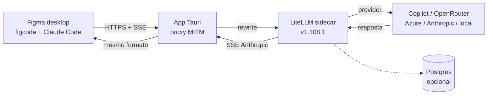

  

# frank-figma-gateway

> App desktop **open source (MIT)** que permite ao Figma usar modelos de LLM de qualquer provedor —
> Copilot, OpenRouter, Azure AI, Anthropic, OpenAI ou um modelo local — sem alterar o app.

## O que é

O Figma desktop executa os recursos de IA (Make Local) através de um agente separado, o `figcode`, que
embute o Claude Code e conversa com o AI Gateway da Figma via HTTPS, no formato **Anthropic Messages
API** com streaming SSE.

Este projeto coloca um **gateway local** nessa perna de inferência: o app continua falando com o
"mesmo lugar" de sempre, mas o gateway traduz a requisição para o provedor/modelo configurado e devolve
a resposta no formato original. O app não sabe que o modelo mudou.

O princípio central é a transparência: **nada de fork do bundle, nada de alterar a UI, nada de
contornar autenticação ou licenciamento**. A intervenção é só de rede, e o uso exige uma conta Figma
com IA habilitada.

O produto é um app **Tauri** que fica no tray, configura a integração com o Figma e usa o
**[LiteLLM](https://github.com/BerriAI/litellm) Proxy** (versão fixada) como engine de providers.
O instalador é mínimo; LiteLLM e Postgres são baixados no onboarding.

## Como funciona

## Stack

- **App:** Tauri v2 (Rust) + React/Vite
- **Proxy:** Rust (MITM seletivo em `api.figma.com`)
- **Engine:** LiteLLM Proxy `v1.108.1` (sidecar)
- **Banco:** Postgres embutido (perfil Copilot); SQLite apenas para estado do app
- **Integração:** CA local + `HTTPS_PROXY`, sem patch no Figma

## Documentação

Índice completo em [docs/index.md](docs/index.md).

| Documento | Conteúdo |
|---|---|
| [Arquitetura da IA no Figma](docs/figma-llm-architecture.md) | Como o app usa LLM hoje: `figcode`, Claude Code, AI Gateway, protocolos e evidências |
| [Arquitetura do gateway](docs/gateway-architecture.md) | Proxy MITM, LiteLLM sidecar, Postgres, roteamento, segurança e testes |
| [App desktop (Tauri)](docs/desktop-app.md) | Janelas, tray, autostart, close-to-tray, supervisão e empacotamento |
| [Instalação e onboarding](docs/onboarding.md) | Instalador mínimo, tour de configuração e download de componentes |
| [Guia de desenvolvimento](docs/dev-guide.md) | Rodar o app, testes, logs, troubleshooting e fluxo de PR |
| [Integração Figma + gateway](docs/figma-gateway-integration.md) | Topologia, interceptação, wizard, tray, troubleshooting e testes |
| [PRD do gateway](docs/gateway-prd.md) | Requisitos, entregáveis por milestone, critérios de aceite, riscos e métricas |

## Status

Mapeamento concluído e arquitetura definida: **viável**. A inferência é um contrato padrão Anthropic,
o endpoint é fixo (`api.figma.com/ai-gateway/llm/provider/universal`), o TLS é configurável e não há
certificate pinning — nenhum patch no app é necessário.

O próximo passo é a prova de conceito: proxy em modo passthrough, captura de `/v1/messages` e
`count_tokens`, e depois o LiteLLM sidecar com o primeiro provedor.

## Licença

Distribuído sob **MIT** — ver [LICENSE](LICENSE). Atribuições de terceiros (LiteLLM, Tauri, Postgres,
React, Vite) em [THIRD_PARTY_NOTICES.md](THIRD_PARTY_NOTICES.md) e
[licenses/litellm-LICENSE](licenses/litellm-LICENSE).

## Escopo

- Não é um crack nem uma modificação de licenciamento/DRM.
- Não altera o binário distribuído: a intervenção é no tráfego local de rede.
- Não redistribui o app nem contorna autenticação da conta do usuário.
- Não substitui o token da Figma; o gateway só troca a perna de inferência.
