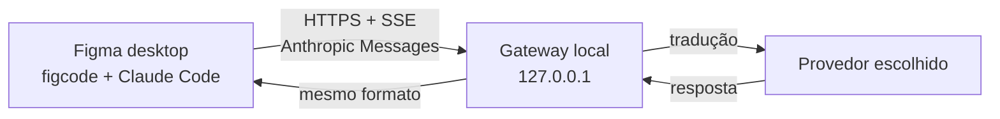

  

# frank-figma-gateway

> Gateway local que permite ao Figma desktop usar modelos de LLM de qualquer provedor — OpenAI,
> Anthropic, Google ou um modelo local — sem alterar o app.

## O que é

O Figma desktop executa os recursos de IA (Make Local) através de um agente separado, o `figcode`, que
embute o Claude Code e conversa com o AI Gateway da Figma via HTTPS, no formato **Anthropic Messages
API** com streaming SSE.

Este projeto coloca um **gateway local** nessa perna de inferência: o app continua falando com o
"mesmo lugar" de sempre, mas o gateway traduz a requisição para o provedor/modelo configurado e devolve
a resposta no formato original. O app não sabe que o modelo mudou.

O princípio central é a transparência: **nada de fork do bundle, nada de alterar a UI, nada de
contornar autenticação ou licenciamento**. A intervenção é só de rede, e o uso exige uma conta Figma
com IA habilitada.

## Como funciona

## Documentação

| Documento | Conteúdo |
|---|---|
| [Arquitetura da IA no Figma](docs/figma-llm-architecture.md) | Como o app usa LLM hoje: `figcode`, Claude Code, AI Gateway, protocolos e evidências |
| [PRD do gateway](docs/gateway-prd.md) | Requisitos, entregáveis por milestone, critérios de aceite, riscos e métricas |
| [Arquitetura do gateway](docs/gateway-architecture.md) | Proxy, MITM seletivo, IR canônica, adapters, SSE, configuração e segurança |
| [Integração Figma + gateway](docs/figma-gateway-integration.md) | Topologia, opções de interceptação, instalação no Windows, fallback e troubleshooting |

## Status

Mapeamento concluído: a ideia é **viável**. A inferência é um contrato padrão Anthropic, o endpoint é
fixo (`api.figma.com/ai-gateway/llm/provider/universal`), o TLS é configurável e não há certificate
pinning — nenhum patch no app é necessário.

O próximo passo é a prova de conceito: proxy em modo passthrough, captura de `/v1/messages` e
`count_tokens`, e depois o tradutor para o primeiro provedor.

## Escopo

- Não é um crack nem uma modificação de licenciamento/DRM.
- Não altera o binário distribuído: a intervenção é no tráfego local de rede.
- Não redistribui o app nem contorna autenticação da conta do usuário.
- Não substitui o token da Figma; o gateway só troca a perna de inferência.
