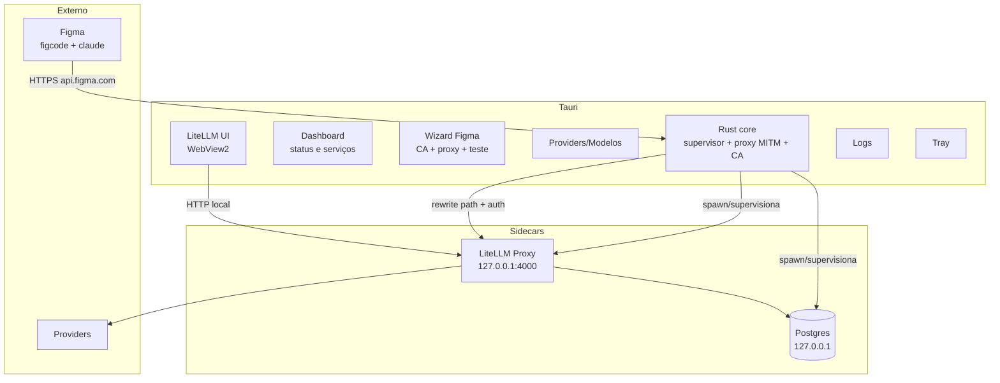

# App desktop (Tauri) — arquitetura

> App Tauri v2 que instala/gerencia os componentes, configura a integração com o Figma e mantém o
> gateway rodando no tray. O instalador é mínimo; LiteLLM e Postgres são baixados sob demanda
> (ver [onboarding.md](onboarding.md)).

## 1. Visão geral



### Responsabilidades

| Componente | Responsabilidade |
|---|---|
| Rust core | Subir/parar sidecars, job object, health checks, restart, portas, CA e proxy |
| Dashboard | Estado de Postgres/LiteLLM/proxy/CA/Figma, iniciar/parar, abrir janelas |
| Wizard Figma | Instalar CA, gravar env, subir proxy, reiniciar Figma, testar |
| Providers/Modelos | Chaves, mapa `claude-*` → provider/modelo, fallback |
| LiteLLM UI | Configuração avançada e OAuth do Copilot |
| Logs | Tail dos processos com redaction |
| Tray | Status, menu, close-to-tray, autostart |

## 2. Processos e supervisão

| Processo | Quando sobe | Observação |
|---|---|---|
| Postgres | perfil Copilot (ou quando o banco é necessário) | `initdb` no first run; dados em `%LOCALAPPDATA%` |
| LiteLLM | sempre | depende do Postgres quando há DB |
| Proxy MITM | quando a integração Figma está ativa | loopback, porta dinâmica |

### Ordem de startup

1. Single-instance check.
2. Carrega config, segredos e `setup.json`.
3. Sobe Postgres (se necessário) e espera aceitar conexão.
4. Sobe LiteLLM com `DATABASE_URL` e espera health.
5. Sobe o proxy e carrega a CA.
6. Garante a integração (CA instalada, env gravado) se o usuário ativou.
7. Tray verde; abre o dashboard só se houver erro ou first-run.

### Shutdown e crash

- Job Object do Windows com `KILL_ON_JOB_CLOSE` garante que filhos não fiquem órfãos.
- Supervisor com backoff: reinicia LiteLLM/Postgres até N vezes; depois marca vermelho e notifica.
- Health checks periódicos (LiteLLM e proxy); Postgres por conexão TCP.
- Ao sair: proxy → LiteLLM → Postgres, nessa ordem.

## 3. Janelas

| Janela | Conteúdo |
|---|---|
| **Dashboard** | Cards de status, botões Iniciar/Parar, “Abrir LiteLLM”, “Reconfigurar Figma”, “Logs” |
| **Wizard Figma** | Detecção do Figma, instalação de CA/env, teste, reinício, rollback |
| **Providers/Modelos** | Chaves, aliases, fallback, teste de conexão |
| **LiteLLM UI** | `http://127.0.0.1:<porta>/ui` em janela Tauri (WebView2) |
| **Logs** | Filtro por processo/nível, copiar, abrir pasta |
| **Sobre/Atualizações** | Versões (app, LiteLLM, Postgres), canal, check de update |

A UI do LiteLLM não deve ser iframe no dashboard (X-Frame-Options); usar `WebviewWindowBuilder` com
`WebviewUrl::External`.

## 4. Tray e fechamento

- Ícone com estado: verde (tudo ok), amarelo (iniciando/degradado), vermelho (erro).
- Menu: Abrir dashboard, Configurar Figma, Abrir LiteLLM, Reiniciar serviços, Logs, Sair.
- `WindowEvent::CloseRequested` → `api.prevent_close()` + `window.hide()`.
- Na primeira vez, notificação: “O gateway continua rodando para o Figma”.
- **Sair** é explícito: encerra serviços e desativa o proxy (remove as variáveis) para o Figma não
  apontar para um proxy morto — com aviso de que o Figma precisa ser reiniciado para voltar ao normal.
- `tauri-plugin-single-instance`: segunda execução foca o dashboard.

## 5. Autostart

- `tauri-plugin-autostart`, por usuário, sem admin.
- Inicia oculto (`--hidden`), sobe serviços e só mostra janela em erro.
- Não é serviço do Windows: a integração é por sessão (CA em `CurrentUser`, env em `HKCU`).

## 6. Segurança

| Item | Decisão |
|---|---|
| Bind | Somente loopback (`127.0.0.1`) |
| Portas | Dinâmicas, persistidas, com detecção de conflito |
| `LITELLM_MASTER_KEY` | Aleatória por instalação, no Credential Manager/DPAPI |
| `LITELLM_SALT_KEY` | Estável (senão tokens do Copilot ficam ilegíveis) |
| CA privada | Protegida, validade curta, remoção no uninstall |
| Logs | Prompt/resposta desligados por padrão; headers sensíveis redigidos |
| Superfície | Sem admin, sem inbound firewall, sem telemetria externa |

## 7. Estrutura de pastas

```text
src/
├── src-tauri/
│   ├── src/
│   │   ├── main.rs
│   │   ├── supervisor.rs     # sidecars, job object, health
│   │   ├── proxy/            # CONNECT, MITM seletivo, rewrite
│   │   ├── ca.rs             # geração/instalação da CA
│   │   ├── env.rs            # HKCU\Environment + WM_SETTINGCHANGE
│   │   ├── postgres.rs       # initdb/pg_ctl
│   │   ├── setup.rs          # estado do onboarding
│   │   ├── tray.rs
│   │   └── commands.rs       # IPC do frontend
│   ├── binaries/             # litellm sidecar (se empacotado)
│   └── resources/            # pgsql, manifest, chaves públicas
├── ui/                       # dashboard, wizard, logs
└── runtime/                  # LiteLLM/Postgres baixados (fora do instalador)
```

## 8. Empacotamento

- Instalador Tauri (NSIS/MSI) só com o shell, wizard, proxy e tray.
- WebView2 bootstrapper quando necessário.
- Componentes pesados baixados no onboarding para `%LOCALAPPDATA%`.
- Code signing recomendado (SmartScreen e confiança da CA).
- Atualização do app pelo `tauri-plugin-updater`; runtime tem versionamento próprio.

## 9. Decisões pendentes

| Tema | Recomendação |
|---|---|
| Frontend | React + Vite (decidido no scaffold) |
| Config de providers | Híbrido: nossa UI para o básico; LiteLLM UI para Copilot/avançado |
| Sair | Desativar a integração (remover env) e avisar |
| Postgres | Baixar só no perfil Copilot |
| Assinatura de código | Assinar instalador e binários |
