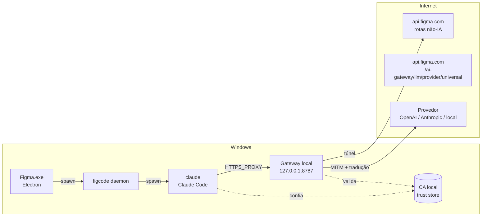
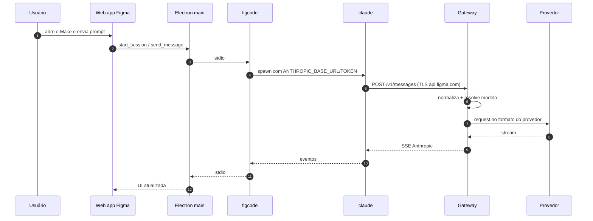

# Integração — Figma + Gateway

> Como o gateway se encaixa no fluxo real do Figma desktop, como instalar/remover e o que fazer quando
> algo quebra. A arquitetura interna está em [gateway-architecture.md](gateway-architecture.md).

## 1. Topologia



### O que muda e o que não muda

| Item | Muda? |
|---|---|
| `FigmaSetup.exe`, `app.asar`, `Figma.exe` | Não |
| UI, fluxos, permissões, ferramentas | Não |
| Token da Figma e renovação | Não (continua web app → Figma) |
| Modelo exibido no seletor | Não (continua o catálogo do Claude Code) |
| Destino real da inferência | Sim (gateway → provedor escolhido) |

## 2. Fluxo ponta a ponta



## 3. Opções de interceptação

| Opção | Como | Prós | Contras | Recomendação |
|---|---|---|---|---|
| **A. Proxy + CA no trust store** | `HTTPS_PROXY=http://127.0.0.1:8787` + CA na store do usuário | Não altera hosts; túnel para o resto; reversível | Requer instalar CA; afeta outros apps que usam o proxy | **Preferida** |
| **B. Proxy + `NODE_EXTRA_CA_CERTS`** | Mesma coisa, mas o `claude` confia via variável | Não mexe na store do sistema | Depende de env herdado pelo `figcode` | Boa para testes |
| **C. `hosts` + reverse proxy** | `api.figma.com → 127.0.0.1` e listener em 443 | Não depende de proxy | Afeta todo o host; precisa encaminhar tudo; mais frágil | Só se proxy não for possível |

### Por que o proxy funciona

- O `main.js` passa `NODE_USE_SYSTEM_CA=1` ao `figcode`, e o `claude` herda o ambiente.
- O Claude Code suporta `NODE_EXTRA_CA_CERTS` e `HTTPS_PROXY`.
- Não há certificate pinning no cliente.
- O `figcode` já sabe usar proxy do sistema (flag `make_local_enable_proxy_discovery`), mas o
  `HTTPS_PROXY` definido no ambiente do usuário também é herdado.

> Importante: `NO_PROXY` deve incluir `localhost,127.0.0.1,::1` para não interceptar MCP/serviços locais.

## 4. Regras de roteamento do proxy

| Host/path | Ação |
|---|---|
| `api.figma.com/ai-gateway/llm/provider/universal/*` | MITM + tradução |
| `api.figma.com/*` (demais paths) | MITM + **forward intacto** ao host real |
| `www.figma.com`, `mcp.figma.com`, `desktop.figma.com` | Túnel CONNECT (sem descriptografar) |
| `127.0.0.1`, `localhost` | Túnel direto (nunca interceptar) |
| Outros hosts | Túnel CONNECT |

O host e o path são **configuráveis** para sobreviver a mudanças de versão do `figcode`
(stable/staging/gov).

## 5. Instalação (Windows)

1. **Gerar a CA local** (primeira execução do gateway): chave + certificado com SAN
   `api.figma.com` e variantes de ambiente.
2. **Confiar na CA**:
   - Opção A: instalar em `Cert:\CurrentUser\Root`.
   - Opção B: definir `NODE_EXTRA_CA_CERTS=C:\caminho\ca.pem` no ambiente do usuário.
3. **Apontar o proxy** (ambiente do usuário):
   ```text
   HTTPS_PROXY=http://127.0.0.1:8787
   HTTP_PROXY=http://127.0.0.1:8787
   NO_PROXY=localhost,127.0.0.1,::1
   ```
4. **Reiniciar o Figma** (as variáveis são lidas no start do processo).
5. **Validar**:
   - `GET http://127.0.0.1:8787/health` responde `ok`.
   - Abrir o Make e enviar um prompt; o log do gateway mostra `POST /v1/messages`.
6. **Desinstalar**: remover a CA, remover as variáveis e parar o gateway. O app volta ao normal.

## 6. Modos de operação

| Modo | Comportamento | Uso |
|---|---|---|
| `passthrough` | Intercepta e reencaminha para a Figma sem traduzir | Validar a instalação |
| `translate` | Traduz para o provedor configurado | Uso normal |
| `fail-open` | Se o provedor/gateway falhar, túnel direto para a Figma | Continuidade |
| `fail-closed` | Erro explícito na UI | Diagnóstico/previsibilidade |

## 7. Atualizações do figcode

- O app baixa o `figcode` por SHA-256 e desliga o self-update do daemon.
- Quando o `claude` sai com código `42`, o main aplica o update e respawna.
- O gateway **não** depende do binário: depende do host e do path.
- Se o path mudar em uma versão futura:
  1. o log mostra requisições para um path novo;
  2. ajustar a regra de roteamento na config (hot reload);
  3. opcional: detectar a versão do `figcode` e avisar.

## 8. Tratamento de falhas

| Sintoma | Causa provável | Ação |
|---|---|---|
| `unable to verify the first certificate` | CA não confiada | Reinstalar CA ou `NODE_EXTRA_CA_CERTS` |
| `407 Proxy Authentication Required` | Proxy com auth | Remover auth ou configurar credencial |
| Make fica "pensando" e não retorna | SSE incompleto / stream pendurado | Verificar `message_stop` e timeouts |
| `400 invalid_request_error` | Campo não traduzido (`cache_control`, beta) | Sanitizar no adapter |
| Tool call não executa | Tradução de `tool_use`/`tool_result` | Conferir mapeamento e `finish_reason` |
| Token expirado no meio do turno | Refresh não propagado | Verificar `request_auth_token_refresh` e retry |
| Outras APIs da Figma quebram | Proxy interceptando demais | Garantir túnel para paths não-IA |

## 9. Matriz de compatibilidade

| Item | Versão validada | Observação |
|---|---|---|
| Figma desktop | 126.11.7 | Artefato analisado |
| figcode | 20261022.212230 (`b823ba69…`) | Baixado pelo app |
| Claude Code | 2.1.308 | Embutido no zip do figcode |
| Windows | 10/11 x64 | Alvo primário |
| macOS/Linux | não validado | Mesmo desenho, binários diferentes |

## 10. Plano de teste da integração

1. **TLS**: gateway no meio, `claude` conecta sem erro de certificado.
2. **Passthrough**: Make funciona igual ao original; nenhum path não-IA afetado.
3. **Tradução Anthropic**: provedor Anthropic direto; texto, tools e streaming.
4. **Tradução OpenAI**: texto e tools; conferir deltas e `finish_reason`.
5. **Erros**: 401, 429, 500 e timeout; UI e retry do agente.
6. **Cancelamento**: parar o turno no meio; provedor recebe abort.
7. **Update**: simular troca de SHA do figcode; gateway continua roteando.
8. **Rollback**: remover CA/proxy; app volta ao comportamento original.

## 11. Segurança e conformidade

- O gateway **não** contorna autenticação: o token continua sendo cunhado pela Figma e o recurso exige
  entitlement.
- Não redistribuir binários da Figma/Claude Code.
- Verificar os termos de uso antes de distribuir o gateway.
- Escutar apenas em loopback; nunca expor a CA ou chaves em repositório.
- Logs com prompts desligados por padrão.
