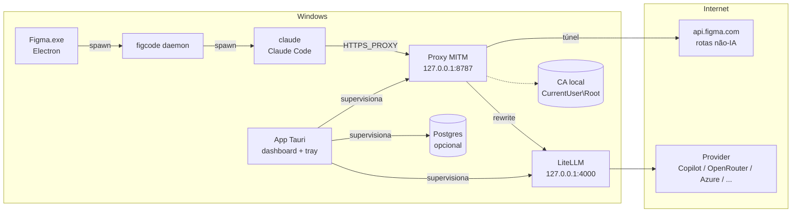
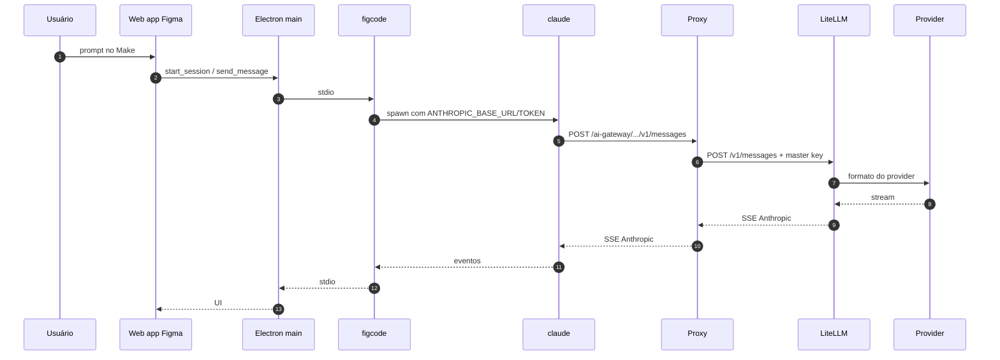

# Integração — Figma + Gateway

> Como o app Tauri encaixa o gateway no fluxo do Figma, instala a integração, mantém tudo no tray e
> como reverter. Arquitetura interna em [gateway-architecture.md](gateway-architecture.md).

## 1. Topologia



### O que muda e o que não muda

| Item | Muda? |
|---|---|
| Arquivos instalados do Figma | Não |
| UI, fluxos, permissões, ferramentas | Não |
| Token da Figma e renovação | Não |
| Nome do modelo no seletor | Não |
| Destino da inferência | Sim |
| Configuração de rede do usuário | Sim (CA + env), reversível |

## 2. Fluxo ponta a ponta



## 3. Opções de interceptação

| Opção | Como | Prós | Contras | Uso |
|---|---|---|---|---|
| **A. Proxy + CA** | `HTTPS_PROXY` + CA em `CurrentUser\Root` | Sem hosts, túnel para o resto, reversível | CA precisa ser confiada; reiniciar Figma | **Padrão do app** |
| B. Proxy + `NODE_EXTRA_CA_CERTS` | Igual, mas sem trust store | Não mexe na store | Depende de env herdado | Testes |
| C. `hosts` + reverse proxy | `api.figma.com → 127.0.0.1` | Sem proxy | Afeta todo o host; frágil | Último recurso |

### Por que funciona

- O processo main passa `NODE_USE_SYSTEM_CA=1` ao figcode; o `claude` herda.
- Claude Code suporta `NODE_EXTRA_CA_CERTS` e `HTTPS_PROXY`.
- Não há certificate pinning.
- O figcode herda `process.env`; `HTTPS_PROXY` é lido no start do Figma.

> `NO_PROXY` deve incluir `localhost,127.0.0.1,::1`.

## 4. Regras de roteamento

| Host/path | Ação |
|---|---|
| `api.figma.com/ai-gateway/llm/provider/universal/*` | MITM + rewrite + auth |
| `api.figma.com/*` | MITM + forward intacto |
| `www.figma.com`, `mcp.figma.com`, `desktop.figma.com` | Túnel CONNECT |
| `127.0.0.1`, `localhost` | Túnel direto |
| Outros | Túnel CONNECT |

Host/path são configuráveis para sobreviver a mudanças do figcode (stable/staging/gov).

## 5. Instalação automatizada

O wizard do app faz, sem admin:

1. gera CA + certificado para `api.figma.com` (e variantes);
2. instala a CA em `Cert:\CurrentUser\Root`;
3. grava `HTTPS_PROXY`, `HTTP_PROXY` e `NO_PROXY` em `HKCU\Environment`;
4. sobe o proxy e valida TLS + rewrite;
5. detecta o Figma aberto e oferece “Fechar e reabrir”;
6. marca “conectado” quando a primeira requisição de IA passa.

**Rollback:** remove CA e variáveis; o Figma volta ao comportamento original após reiniciar.

### Instalação manual (fallback)

Se política corporativa bloquear o wizard:

```text
HTTPS_PROXY=http://127.0.0.1:8787
HTTP_PROXY=http://127.0.0.1:8787
NO_PROXY=localhost,127.0.0.1,::1
```

E instalar a CA exportada pelo app em “Autoridades de Certificação Raiz Confiáveis” do usuário.

## 6. Modos de operação

| Modo | Comportamento | Uso |
|---|---|---|
| `passthrough` | Reencaminha para a Figma sem traduzir | Validar instalação |
| `translate` | Traduz para o provider configurado | Uso normal |
| `fail-open` | Se o LiteLLM falhar, túnel direto para a Figma | Continuidade |
| `fail-closed` | Erro explícito | Diagnóstico |

O padrão é `translate` com `fail-closed`; fail-open é opcional (usa o modelo da Figma).

## 7. Tray, autostart e fechamento

- O app fica no tray; fechar a janela (X) não encerra.
- Menu: Abrir dashboard, Configurar Figma, Abrir LiteLLM, Reiniciar serviços, Logs, Sair.
- Autostart no login, oculto; serviços sobem sozinhos.
- **Sair** encerra proxy/LiteLLM/Postgres e **desativa o proxy do Figma** (remove env), avisando que o
  Figma precisa ser reiniciado para voltar ao normal.
- Single instance: segunda execução foca o dashboard.

## 8. Atualizações do figcode

- O app baixa o figcode por SHA-256 e desliga o self-update do daemon.
- `claude` sai com código 42 para aplicar update; o main respawna.
- A integração é por host/path, não por binário; updates não quebram o gateway.
- Se o path mudar: ajustar a regra na config (hot reload) e avisar.

## 9. Tratamento de falhas

| Sintoma | Causa provável | Ação |
|---|---|---|
| `unable to verify the first certificate` | CA não confiada | Reinstalar CA pelo wizard |
| `407 Proxy Authentication Required` | Proxy com auth | Remover auth |
| Make não responde | SSE incompleto / LiteLLM caído | Ver logs e health |
| `400 invalid_request_error` | Campo não suportado | Ajustar config/adapter LiteLLM |
| Tool call não executa | Tradução de `tool_use` | Conferir provider e logs |
| Copilot 401 | OAuth expirado/desconectado | Reconectar no LiteLLM UI |
| Copilot “model not supported” | Plano sem o modelo | Escolher modelo permitido |
| Postgres não sobe | Porta/dados/migração | Reiniciar serviço; ver logs |
| Outras APIs quebram | Proxy interceptando demais | Garantir túnel para não-IA |

## 10. Matriz de compatibilidade

| Item | Versão validada |
|---|---|
| Figma desktop | 126.11.7 |
| figcode | 20261022.212230 |
| Claude Code | 2.1.308 |
| LiteLLM | `v1.108.1` |
| Postgres | 16.x |
| Windows | 10/11 x64 |

## 11. Plano de teste

1. TLS: `claude` conecta sem erro de certificado.
2. Passthrough: Make funciona igual ao original.
3. Tradução Anthropic: texto, tools e streaming.
4. Tradução OpenAI/OpenRouter/Azure: idem.
5. Copilot: OAuth, refresh, modelo do plano e `/v1/messages`.
6. Erros: 401, 429, 500 e timeout.
7. Cancelamento no meio do stream.
8. Update do figcode e do runtime com rollback.
9. Rollback da integração (CA/env) e volta ao normal.

## 12. Segurança e conformidade

- Não contorna autenticação; exige conta Figma com IA.
- Não redistribui binários da Figma/Claude Code.
- Verificar ToS de Copilot/assinaturas antes de distribuir.
- Loopback apenas; segredos no Credential Manager; logs redigidos.
