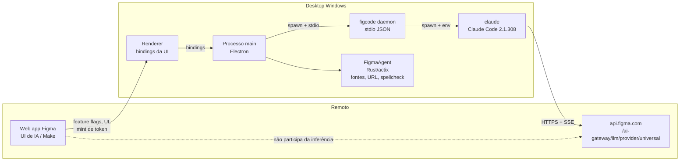
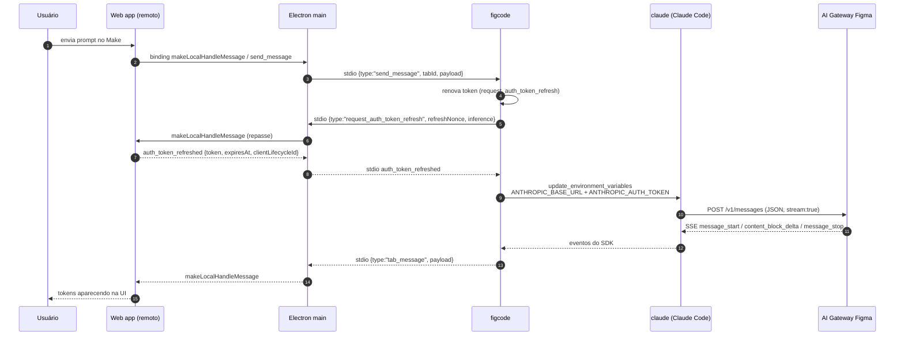
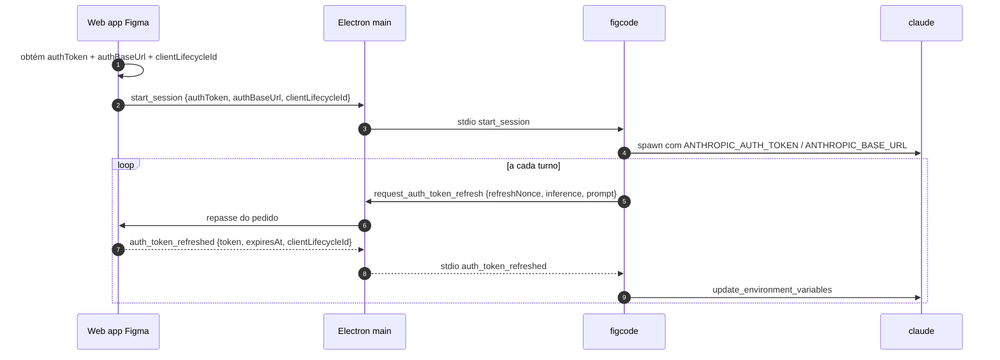

# Arquitetura — Como o app da Figma usa modelos de LLM

> Descrição do fluxo de IA do Figma desktop (`figcode`, Claude Code e AI Gateway) e do contrato
> usado na inferência. Reflete o comportamento do produto; pontos marcados como **a confirmar**
> dependem de validação em execução.

## 1. Visão geral

A inferência **não** acontece no processo Electron. O app usa um agente separado (`figcode`), que
embute o **Claude Code** e fala com o **AI Gateway** da Figma por HTTPS no formato
**Anthropic Messages API** com streaming SSE.



### Responsabilidades

| Componente | Responsabilidade | Tecnologia |
|---|---|---|
| Web app (remoto) | UI de IA, feature flags, cunhar token de inferência por turno | JS da Figma |
| Renderer | Bindings entre a UI e o processo main | Electron |
| Processo main | Ciclo de vida do `figcode`, download/atualização, handshake stdio, roteamento por tab | Node/Electron |
| `figcode` | Daemon do agente; sessões, ferramentas MCP, sandbox, tradução de eventos | Bun |
| `claude` | Cliente de inferência (loop do agente, tool use, streaming) | Claude Code 2.1.308 |
| AI Gateway (`api.figma.com`) | Endpoint compatível com Anthropic Messages; autenticação e roteamento dos modelos Figma | Serviço Figma |
| `FigmaAgent` | Serviços locais nativos (fontes, abrir URL, spellcheck) | Rust/actix-web |

## 2. Fluxo de uma mensagem



## 3. Protocolo Electron ↔ figcode (stdio JSON)

O processo main spawna `figcode daemon` com `stdio: "pipe"` e troca **uma linha JSON por mensagem**.
Não há HTTP, WebSocket nem protobuf nessa perna.

### Handshake

Mensagem enviada pelo main após o spawn:

```json
{
  "id": "1",
  "type": "initialize",
  "tabId": "<tab>",
  "meta": { "version": "126.11.7", "buildId": "<build>" },
  "messageTypes": ["..."],
  "desktopApiFeatures": { "makeLocalBrowserPreviewMessages": 190, "figcodeMcpProxyMode": 188 },
  "desktopApiVersion": 218,
  "desktopBackportedFeatures": []
}
```

O daemon responde `initialized` com `meta.version`; só então o processo é considerado `running`.

### Variáveis de ambiente relevantes no spawn

| Variável | Origem | Papel |
|---|---|---|
| `FIGMA_MCP_TOKEN` | token OAuth obtido pelo web app | Autentica o MCP (`mcp.figma.com/mcp`), **não** a inferência |
| `FIGMA_MCP_URL` | `w5()` | `https://mcp.figma.com/mcp` (staging/gov variam) |
| `FIGCODE_ENV` | canal (`stable`/`staging`) | Comportamento do agente |
| `FIGCODE_USER_DIR` | `<userData>/FigcodeData` | Estado local do agente |
| `FIGCODE_DISABLE_SELF_UPDATE` | `"1"` | Atualização é orquestrada pelo Electron |
| `NODE_USE_SYSTEM_CA` | `"1"` | Trust store do sistema para TLS |
| `FIGCODE_MAKE_LOCAL_SYSTEM_PROMPT_ENABLED` | flag | Prompt de sistema do Make Local |
| `HTTPS_PROXY` / `HTTP_PROXY` | proxy injetado no processo do Figma pelo app (não global) | Descoberto atrás da flag `make_local_enable_proxy_discovery` |

### Tipos de mensagem (amostra)

- **Main → figcode**: `initialize`, `start_session`, `send_message`, `set_model`,
  `get_supported_models`, `get_supported_commands`, `permission_response`, `interrupt`,
  `update_mcp_token`, `pause_and_refresh_mcp_token`, `shutdown`.
- **figcode → Main**: `initialized`, `tab_message`, `agent_message`, `model_changed`,
  `supported_models`, `supported_commands`, `permission_request`, `request_auth_token_refresh`,
  `ready_for_mcp_token_refresh`, `request_mcp_token_refresh`, `log`, `send_metrics`,
  `cli_fatal_error`.

## 4. Protocolo claude ↔ AI Gateway (HTTPS + SSE)

### Base URL e endpoints

O `figcode` monta o ambiente do filho `claude` com:

```
ANTHROPIC_BASE_URL=<authBaseUrl>   # termina em /ai-gateway/llm/provider/universal
ANTHROPIC_AUTH_TOKEN=<token escopado>
ANTHROPIC_DEFAULT_HAIKU_MODEL=claude-haiku-4-5
CLAUDE_CODE_AUTO_COMPACT_WINDOW=500000
CLAUDE_CODE_PROVIDER_MANAGED_BY_HOST=1
CLAUDE_CODE_DISABLE_NONESSENTIAL_TRAFFIC=1
```

O path do gateway termina em `/ai-gateway/llm/provider/universal`.

Endpoints usados pelo cliente:

| Método | Caminho (relativo ao base URL) | Uso |
|---|---|---|
| `POST` | `/v1/messages` | Inferência (streaming SSE e não-streaming) |
| `POST` | `/v1/messages/count_tokens?beta=true` | Contagem de tokens de contexto |
| — | `/v1/messages/cache_touch`, `/v1/messages/batches` | Endpoints adicionais do cliente; uso no fluxo Make **a confirmar** |

A rota responde 401 sem autenticação:

```text
GET https://api.figma.com/ai-gateway/llm/provider/universal/v1/messages       -> 401 Unauthorized
GET https://api.staging.figma.com/ai-gateway/llm/provider/universal/v1/messages -> 401
GET https://api.figma-gov.com/ai-gateway/llm/provider/universal/v1/messages     -> 401
```

### Headers

| Header | Conteúdo |
|---|---|
| `Authorization` | `Bearer <ANTHROPIC_AUTH_TOKEN>` |
| `anthropic-version` | versão da API Anthropic |
| `anthropic-beta` | betas experimentais (cache, thinking, contexto) |
| `user-agent` | identificação do Claude Code |
| `x-stainless-*` | headers do SDK Anthropic |
| headers customizados | `clientLifecycleId`, `supportRequestId` (via `ANTHROPIC_CUSTOM_HEADERS`) |

### Corpo

Formato **Anthropic Messages API** (campos padrão `model`, `max_tokens`, `system`, `messages`,
`tools`, `stream`, `metadata`, opcionalmente `thinking` e `cache_control`). O corpo exato de uma sessão
real ainda precisa de captura.

### Streaming

`Accept: text/event-stream`; eventos padrão do protocolo Anthropic:

```text
message_start
content_block_start
content_block_delta   (text_delta | input_json_delta | thinking_delta)
content_block_stop
message_delta
message_stop
```

O agente depende dos deltas incrementais para renderizar a resposta na UI e para montar `tool_use`.

### Erros

Formato Anthropic:

```json
{ "type": "error", "error": { "type": "authentication_error", "message": "..." } }
```

Status HTTP são usados pelo cliente para retry, refresh de token e mensagens na UI.

## 5. Autenticação e ciclo do token



Características:

- O token é **escopado, efêmero e por turno**; a renovação é reativa/proativa.
- A capacidade `scoped_inference_auth_refresh` é negociada com o web client; se ele não a suportar, o
  `figcode` recusa renovar.
- O `FIGMA_MCP_TOKEN` é um token **separado**, para o MCP, e não serve para inferência.
- O token nunca passa pelo Electron como "chave de provedor": o `claude` o envia direto ao gateway.

## 6. Seleção de modelo

Validado no Figma desktop **126.11.7** (bundle do web app no cache do perfil + `app.asar`).

- A escolha é **do cliente**, não do servidor da Figma: a UI envia `set_model` ao agente local
  (`figcode`) e o agente usa o id no corpo de `/v1/messages`.
- **Catálogo:** vem de `get_supported_models` → resposta `supported_models`, um canal **IPC/stdio**
  com o agente local — não é um endpoint HTTP. O web app guarda só a lista de ids conhecidos e o
  nome exibido de cada um (um `switch` fixo no bundle).
- **Consequência:** o proxy **não consegue injetar modelos no seletor**. A lista nunca passa pela
  rede, e um id desconhecido nem é exibido.
- **O que o proxy controla:** o id que chega no corpo de `/v1/messages`. Ele pode ser reescrito ou
  mapeado para uma rota do LiteLLM, trocando o modelo real sem tocar na UI.

### Ids observados no seletor do Make

Codenames da Figma (não são os ids nativos do Claude Code):

| Id | Nome exibido |
|---|---|
| `default` | Auto |
| `anthropic-claude-5.5-opus` / `anthropic-claude-5.5-sonnet` | Claude Opus 5.5 / Sonnet 5.5 |
| `anthropic-claude-5-opus` / `anthropic-claude-5-sonnet` | Claude Opus 5 / Sonnet 5 |
| `anthropic-claude-4.8-opus`, `anthropic-claude-4.6-opus` / `-sonnet` | versões anteriores |
| `figaro-gpt-6-sol`, `figaro-gpt-6-astra`, `figaro-gpt-6-luna` | Figaro · GPT-6 |
| `figaro-gpt-5.6-sol` / `figaro-gpt-5.6-terra`, `figaro-sonnet-4.6` | Figaro · GPT-5.6 / Sonnet 4.6 |
| `aqua` | Gemini 4 Argon |
| `google-gemini-3.8-flash`, `google-gemini-3-flash`, `google-gemini-3.1-pro` | Gemini |
| `velvet`, `goldenrod`, `emerald`, `tangelo` | codenames sem provedor revelado |

O agente também configura o filho `claude` com ids nativos do Claude Code
(`ANTHROPIC_DEFAULT_HAIKU_MODEL=claude-haiku-4-5`), então o mapeamento precisa aceitar **as duas
famílias**: codenames da Figma e ids `claude-*`/`anth-*`.

> Ainda não confirmado em execução: qual id chega no corpo em cada fluxo (Make, agente, tarefas
> auxiliares) e se o agente encaminha o codename da Figma sem tradução.

## 7. TLS, proxy e integridade

| Item | Situação |
|---|---|
| Certificate pinning | **Não encontrado** no cliente de inferência |
| Trust store | `NODE_USE_SYSTEM_CA=1` passado pelo app ao `figcode`; Claude Code também suporta `NODE_EXTRA_CA_CERTS` |
| Proxy | `HTTPS_PROXY`/`HTTP_PROXY`/`NO_PROXY` honrados, injetados apenas no processo do Figma; descoberta automática atrás da flag `make_local_enable_proxy_discovery` |
| Atualização | pacote do figcode verificado por checksum antes de instalar |
| Pacote do app | assinatura própria; não é alterado pelo gateway |
| Atualização | `figcode` sai com código `42` para aplicar update; o main respawna |

## 8. O que não é a chamada de IA

| Componente | Natureza | Por que não é IA |
|---|---|---|
| `proxy_agent` | Pacote npm `proxy-agent` (HTTP/HTTPS/SOCKS) | Usado no LiveGraph (WebSocket do arquivo) |
| `FigmaAgent` (agente nativo) | Rust/actix-web | Fontes, `can-open-url`, spellcheck, updater |
| `codegen_mcp_server` | Servidor MCP | Expõe ferramentas de codegen; `text/event-stream` é transporte MCP |
| `fcm_manager` | Firebase Cloud Messaging | Push notifications |
| `livegraph_schema` | Schema do LiveGraph | Sincronização do documento |

## 9. Limitações

- O corpo, os headers e a sequência SSE exatos ainda precisam ser confirmados em execução.
- O host e o path podem variar por ambiente (stable, staging, gov).
- O gateway será substituído; a validação do token original não é relevante para o gateway.
- O catálogo e os codenames de modelo mudam entre versões do Figma (validado na 126.11.7); o
  mapeamento precisa ser configurável, não hardcoded.
