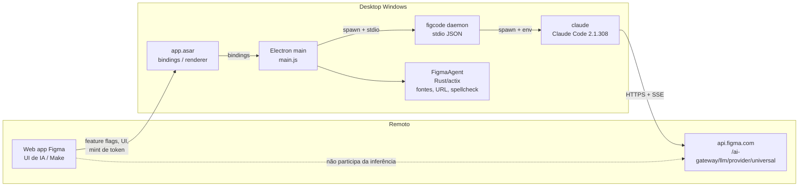
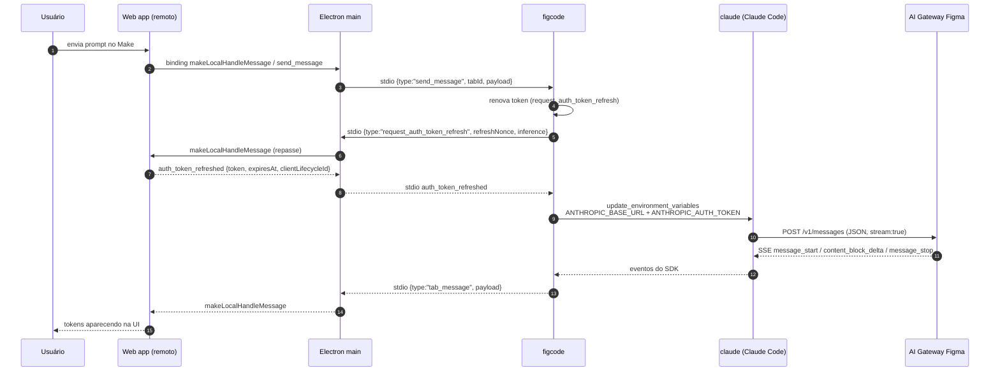
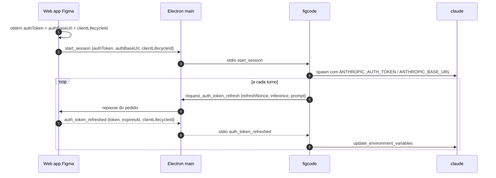

# Arquitetura — Como o app da Figma usa modelos de LLM

> Documento de engenharia reversa do artefato `FigmaSetup.exe` **126.11.7** e do agente `figcode`
> **20261022.212230** (SHA `b823ba69d4c8ff3bbb8fa8e6947b37c2e1a9c109`).
> Baseado em análise estática dos binários e em um probe HTTP da rota do gateway. Não houve captura de
> tráfego em runtime; os pontos marcados como **a confirmar** exigem essa captura.

## 1. Visão geral

A inferência **não** acontece no processo Electron e **não** passa pelo `app.asar`. O app baixa um
agente separado (`figcode`), que embute o **Claude Code** e fala com o **AI Gateway** da Figma por HTTPS
no formato **Anthropic Messages API** com streaming SSE.



### Responsabilidades

| Componente | Responsabilidade | Tecnologia |
|---|---|---|
| Web app (remoto) | UI de IA, feature flags, cunhar token de inferência por turno | JS da Figma |
| `app.asar` (renderer) | Bindings entre a UI e o processo main | Electron |
| `main.js` | Ciclo de vida do `figcode`, download/atualização, handshake stdio, roteamento por tab | Node/Electron |
| `figcode` | Daemon do agente; sessões, ferramentas MCP, sandbox, tradução de eventos | Bun |
| `claude` | Cliente de inferência (loop do agente, tool use, streaming) | Claude Code 2.1.308 |
| AI Gateway (`api.figma.com`) | Endpoint compatível com Anthropic Messages; autenticação e roteamento dos modelos Figma | Serviço Figma |
| `FigmaAgent` | Serviços locais nativos (fontes, abrir URL, spellcheck) | Rust/actix-web |

## 2. Fluxo de uma mensagem



## 3. Protocolo Electron ↔ figcode (stdio JSON)

O `main.js` spawna `figcode daemon` com `stdio: "pipe"` e troca **uma linha JSON por mensagem**.
Não há HTTP, WebSocket nem protobuf nessa perna.

### Handshake

Mensagem enviada pelo main após o spawn:

```json
{
  "id": "1",
  "type": "initialize",
  "tabId": "<tab>",
  "meta": { "version": "126.11.7", "buildId": "<build>" },
  "messageTypes": ["..."],
  "desktopApiFeatures": { "makeLocalBrowserPreviewMessages": 190, "figcodeMcpProxyMode": 188 },
  "desktopApiVersion": 218,
  "desktopBackportedFeatures": []
}
```

O daemon responde `initialized` com `meta.version`; só então o processo é considerado `running`.

### Variáveis de ambiente relevantes no spawn

| Variável | Origem | Papel |
|---|---|---|
| `FIGMA_MCP_TOKEN` | token OAuth obtido pelo web app | Autentica o MCP (`mcp.figma.com/mcp`), **não** a inferência |
| `FIGMA_MCP_URL` | `w5()` | `https://mcp.figma.com/mcp` (staging/gov variam) |
| `FIGCODE_ENV` | canal (`stable`/`staging`) | Comportamento do agente |
| `FIGCODE_USER_DIR` | `<userData>/FigcodeData` | Estado local do agente |
| `FIGCODE_DISABLE_SELF_UPDATE` | `"1"` | Atualização é orquestrada pelo Electron |
| `NODE_USE_SYSTEM_CA` | `"1"` | Trust store do sistema para TLS |
| `FIGCODE_MAKE_LOCAL_SYSTEM_PROMPT_ENABLED` | flag | Prompt de sistema do Make Local |
| `HTTPS_PROXY` / `HTTP_PROXY` | proxy do sistema (opcional) | Descoberto atrás da flag `make_local_enable_proxy_discovery` |

### Tipos de mensagem (amostra)

- **Main → figcode**: `initialize`, `start_session`, `send_message`, `set_model`,
  `get_supported_models`, `get_supported_commands`, `permission_response`, `interrupt`,
  `update_mcp_token`, `pause_and_refresh_mcp_token`, `shutdown`.
- **figcode → Main**: `initialized`, `tab_message`, `agent_message`, `model_changed`,
  `supported_models`, `supported_commands`, `permission_request`, `request_auth_token_refresh`,
  `ready_for_mcp_token_refresh`, `request_mcp_token_refresh`, `log`, `send_metrics`,
  `cli_fatal_error`.

## 4. Protocolo claude ↔ AI Gateway (HTTPS + SSE)

### Base URL e endpoints

O `figcode` monta o ambiente do filho `claude` com:

```
ANTHROPIC_BASE_URL=<authBaseUrl>   # termina em /ai-gateway/llm/provider/universal
ANTHROPIC_AUTH_TOKEN=<token escopado>
ANTHROPIC_DEFAULT_HAIKU_MODEL=claude-haiku-4-5
CLAUDE_CODE_AUTO_COMPACT_WINDOW=500000
CLAUDE_CODE_PROVIDER_MANAGED_BY_HOST=1
CLAUDE_CODE_DISABLE_NONESSENTIAL_TRAFFIC=1
```

Constante que define o path (no bundle do `figcode`):

```text
EXPECTED_AI_GATEWAY_AUTH_BASE_URL_SUFFIX = "/ai-gateway/llm/provider/universal"
```

Endpoints usados pelo cliente:

| Método | Caminho (relativo ao base URL) | Uso |
|---|---|---|
| `POST` | `/v1/messages` | Inferência (streaming SSE e não-streaming) |
| `POST` | `/v1/messages/count_tokens?beta=true` | Contagem de tokens de contexto |
| — | `/v1/messages/cache_touch`, `/v1/messages/batches` | Presentes no binário; uso no fluxo Make **a confirmar** |

Probe (sem token) confirma a rota:

```text
GET https://api.figma.com/ai-gateway/llm/provider/universal/v1/messages       -> 401 Unauthorized
GET https://api.staging.figma.com/ai-gateway/llm/provider/universal/v1/messages -> 401
GET https://api.figma-gov.com/ai-gateway/llm/provider/universal/v1/messages     -> 401
```

### Headers

| Header | Conteúdo |
|---|---|
| `Authorization` | `Bearer <ANTHROPIC_AUTH_TOKEN>` |
| `anthropic-version` | versão da API Anthropic |
| `anthropic-beta` | betas experimentais (cache, thinking, contexto) |
| `user-agent` | identificação do Claude Code |
| `x-stainless-*` | headers do SDK Anthropic |
| headers customizados | `clientLifecycleId`, `supportRequestId` (via `ANTHROPIC_CUSTOM_HEADERS`) |

### Corpo

Formato **Anthropic Messages API** (campos padrão `model`, `max_tokens`, `system`, `messages`,
`tools`, `stream`, `metadata`, opcionalmente `thinking` e `cache_control`). O corpo exato de uma sessão
real ainda precisa de captura.

### Streaming

`Accept: text/event-stream`; eventos padrão do protocolo Anthropic:

```text
message_start
content_block_start
content_block_delta   (text_delta | input_json_delta | thinking_delta)
content_block_stop
message_delta
message_stop
```

O agente depende dos deltas incrementais para renderizar a resposta na UI e para montar `tool_use`.

### Erros

Formato Anthropic:

```json
{ "type": "error", "error": { "type": "authentication_error", "message": "..." } }
```

Status HTTP são usados pelo cliente para retry, refresh de token e mensagens na UI.

## 5. Autenticação e ciclo do token



Características:

- O token é **escopado, efêmero e por turno**; a renovação é reativa/proativa.
- A capacidade `scoped_inference_auth_refresh` é negociada com o web client; se ele não a suportar, o
  `figcode` recusa renovar.
- O `FIGMA_MCP_TOKEN` é um token **separado**, para o MCP, e não serve para inferência.
- O token nunca passa pelo Electron como "chave de provedor": o `claude` o envia direto ao gateway.

## 6. Seleção de modelo

- A escolha é **do cliente** (`figcode`/Claude Code), não do servidor da Figma.
- Catálogo: retornado pelo `initialize` do Claude Code (`supportedModels()`), com nomes como
  `claude-opus-4-8` (default, "Opus 4.8 · Recommended") e `claude-haiku-4-5` (tarefas auxiliares).
- Aliases `default` e `opus` resolvem para `claude-opus-4-8`; `set_model` recebe o nome escolhido.
- O nome do modelo viaja no corpo de `/v1/messages`; o gateway pode reescrevê-lo.
- Consequência: é possível trocar o modelo real sem tocar na UI, mas o **nome exibido** no seletor
  continua sendo o do catálogo do Claude Code.

## 7. TLS, proxy e integridade

| Item | Situação |
|---|---|
| Certificate pinning | **Não encontrado** no cliente de inferência |
| Trust store | `NODE_USE_SYSTEM_CA=1` passado pelo app ao `figcode`; Claude Code também suporta `NODE_EXTRA_CA_CERTS` |
| Proxy | `HTTPS_PROXY`/`HTTP_PROXY`/`NO_PROXY` honrados; descoberta automática atrás da flag `make_local_enable_proxy_discovery` |
| Download do figcode | SHA-256 verificado contra o `checksum` de `UPDATE.json` |
| `app.asar` | Header próprio com `/.codesign`; irrelevante para interceptação de rede |
| Atualização | `figcode` sai com código `42` para aplicar update; o main respawna |

## 8. O que não é a chamada de IA

| Artefato | Natureza | Por que não é IA |
|---|---|---|
| `lazy/external/proxy_agent.js` | Pacote npm `proxy-agent` (HTTP/HTTPS/SOCKS) | Usado no LiveGraph (WebSocket do arquivo) |
| `resources/FigmaAgent/figma_agent.exe` | Rust/actix-web | Fontes, `can-open-url`, spellcheck, updater |
| `lazy/external/codegen_mcp_server.js` | Servidor MCP | Expõe ferramentas de codegen; `text/event-stream` é transporte MCP |
| `lazy/external/fcm_manager.js` | Firebase Cloud Messaging | Push notifications |
| `lazy/external/livegraph_schema.js` | Schema do LiveGraph | Sincronização do documento |

## 9. Evidências

| Fato | Onde foi verificado |
|---|---|
| Spawn do `figcode` e env | `app-asar/main.js` (`RPe()`, `dV()`, `FIGMA_MCP_TOKEN`) |
| Download/checksum | `app-asar/main.js` (`iPe()` compara SHA-256 com `checksum`) |
| Sufixo do gateway | `figcode`: `EXPECTED_AI_GATEWAY_AUTH_BASE_URL_SUFFIX` |
| `ANTHROPIC_BASE_URL`/`TOKEN` | `figcode`: `getGatewaySettingsEnv` / `getGatewayProcessEnv` |
| Refresh de token | `figcode`: `AgentSession.maybeRefreshAuthToken`, `request_auth_token_refresh` |
| Modelo default | `figcode`: `MODEL_OPUS_48 = "claude-opus-4-8"` |
| Endpoints | `claude`: `/v1/messages`, `/v1/messages/count_tokens?beta=true`, `text/event-stream` |
| Host/rota | Probe HTTP: 401 em `api.figma.com` e variantes |
| Versões | `figcode --version`; `claude --version` |

## 10. Limitações do mapeamento

- Sem captura de tráfego real: corpo, headers exatos e sequência completa de SSE ainda não foram
  observados em execução.
- O host é inferido por constante + probe; o valor é cunhado pelo web client e pode variar por ambiente.
- Não foi verificado se o gateway valida o token de forma que o agente perceba (o gateway será
  substituído, então em tese é irrelevante).
- O catálogo de modelos pode mudar entre versões do Claude Code.
