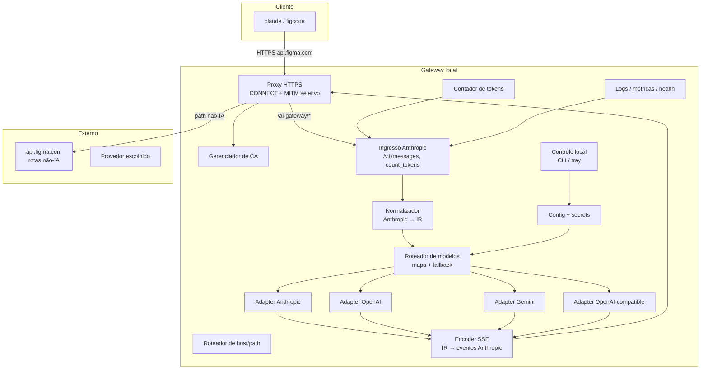
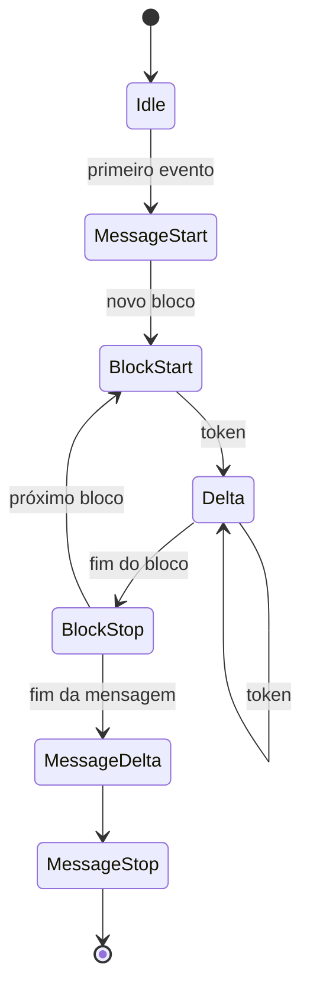
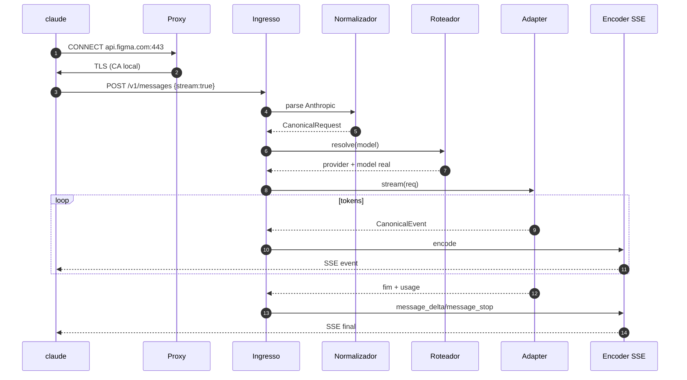

# Arquitetura — Gateway

> Arquitetura **proposta** para o `frank-figma-gateway`. O app da Figma é o cliente existente; este
> documento descreve o processo local que se coloca na perna de inferência e traduz o contrato.
> Requisitos e entregáveis estão em [gateway-prd.md](gateway-prd.md).

## 1. Princípios

1. **Transparência total** — o cliente (`figcode`/`claude`) não pode perceber a troca.
2. **Streaming primeiro** — nada de bufferizar a resposta inteira.
3. **Fidelidade de contrato** — erros, `stop_reason`, tool calls e contagem de tokens no formato
   Anthropic.
4. **Isolamento por adapter** — cada provedor em um módulo; o núcleo não conhece SDK de fornecedor.
5. **Local por padrão** — escuta só em loopback; nenhuma telemetria externa.
6. **Passthrough como cidadão de primeira classe** — tudo que não é IA passa intacto; modo
   passthrough total disponível.

## 2. Componentes



### 2.1 Proxy e MITM

- Escuta em `127.0.0.1:<porta>` como **proxy HTTP** (método `CONNECT`).
- Para hosts que não sejam `api.figma.com`, faz **túnel TCP puro** (não descriptografa).
- Para `api.figma.com`, descriptografa com certificado emitido pela CA local e:
  - se o path casa com `/ai-gateway/llm/provider/universal/*`, entrega ao ingresso;
  - caso contrário, **reencaminha** a requisição ao host real e devolve a resposta sem alteração.
- O certificado apresentado tem SAN `api.figma.com` (e variantes de ambiente configuradas).
- A CA local é gerada no primeiro uso, com validade curta e remoção documentada.

> Alternativa sem proxy: `hosts` + reverse proxy na porta 443. É mais invasiva (afeta todo o host),
> por isso o proxy é a opção recomendada. Ver [figma-gateway-integration.md](figma-gateway-integration.md).

### 2.2 Ingresso Anthropic

Expõe, para o proxy, os endpoints que o Claude Code usa:

| Endpoint | Comportamento |
|---|---|
| `POST /v1/messages` | Converte para IR, aplica rota de modelo, chama adapter, devolve JSON ou SSE |
| `POST /v1/messages/count_tokens` | Usa o contador do adapter ou um estimador local |
| `GET /health` | Estado do gateway, versão, provedores e último erro |

Responsabilidades:

- Validar o corpo mínimo (model, messages, max_tokens).
- Extrair `stream` e negociar `Accept`.
- Preservar/ignorar headers do cliente conforme a política.
- Garantir que o `Authorization` da Figma **não** vaze para o provedor.

### 2.3 Normalizador e IR

O núcleo trabalha com um **modelo intermediário canônico**. Nenhum adapter vê JSON específico de
outro provedor.

```text
CanonicalRequest
├── model: string                # nome lógico recebido (ex.: claude-opus-4-8)
├── system: Block[]
├── messages: Message[]          # role: user | assistant
├── tools: ToolDef[]
├── toolChoice: auto | any | tool(name)
├── maxTokens: number
├── temperature?: number
├── stream: boolean
└── metadata?: Record<string, string>

Message
├── role
└── content: Block[]

Block (união)
├── text { text }
├── image { mediaType, data|url }
├── tool_use { id, name, input }
├── tool_result { toolUseId, content, isError }
└── thinking { text, signature? }   # pode ser descartado por adapter

ToolDef { name, description, inputSchema }

CanonicalEvent (streaming)
├── message_start { id, model, usage? }
├── content_block_start { index, block }
├── content_block_delta { index, delta }
├── content_block_stop { index }
├── message_delta { stopReason, usage }
└── message_stop
```

Regras de normalização:

- `cache_control` é removido do IR e reaplicado apenas no adapter Anthropic, quando suportado.
- Blocos `thinking` são preservados no IR, mas o adapter decide descartar/emular.
- `tool_result` com conteúdo multimodal é achatado para texto quando o provedor não suporta.
- `system` é uma lista de blocos; adapters que só aceitam string concatenam com separador estável.

### 2.4 Roteador de modelos

```yaml
routes:
  claude-opus-4-8:
    provider: openai
    model: gpt-5.2
    fallback:
      - provider: anthropic
        model: claude-opus-4-8
  claude-haiku-4-5:
    provider: local
    model: qwen3-8b
    baseUrl: http://127.0.0.1:11434/v1

defaults:
  provider: anthropic
  model: claude-opus-4-8

providers:
  anthropic:
    baseUrl: https://api.anthropic.com
    apiKeyEnv: ANTHROPIC_API_KEY
  openai:
    baseUrl: https://api.openai.com/v1
    apiKeyEnv: OPENAI_API_KEY
  local:
    baseUrl: http://127.0.0.1:11434/v1
    apiKeyEnv: LOCAL_API_KEY
```

- O mapa usa o nome **recebido** do cliente como chave.
- Aliases (`default`, `opus`) são resolvidos antes do mapa.
- `fallback` só é acionado em erros elegíveis (timeout, 5xx, rate limit), nunca em 400 do cliente.
- Hot reload: mudanças de config são aplicadas na próxima requisição, sem reiniciar o app.

### 2.5 Adapters

Contrato comum (pseudo-TypeScript):

```ts
interface ProviderAdapter {
  readonly name: string;

  complete(req: CanonicalRequest, ctx: RequestContext): Promise<CanonicalResponse>;

  stream(req: CanonicalRequest, ctx: RequestContext): AsyncIterable<CanonicalEvent>;

  countTokens(req: CanonicalRequest, ctx: RequestContext): Promise<number>;
}
```

| Adapter | Tradução | Observações |
|---|---|---|
| Anthropic | IR → Messages API | Passthrough de provedor; preserva cache/thinking |
| OpenAI | IR → Chat Completions | Tools, `tool_calls`, streaming por deltas |
| Gemini | IR → generateContent | Tool calling e system instruction |
| OpenAI-compatible | IR → Chat Completions | Ollama, vLLM, LM Studio, Azure-compatible |

Pontos de tradução críticos:

| Anthropic | OpenAI |
|---|---|
| `system` (blocos) | mensagem `system` concatenada |
| `tool_use` / `tool_result` | `tool_calls` / mensagem `tool` |
| `stop_reason: tool_use` | `finish_reason: tool_calls` |
| `max_tokens` | `max_completion_tokens` (quando aplicável) |
| `content_block_delta` | `choices[0].delta.content` |
| `input_json_delta` | fragmentos de `function.arguments` |
| erro `{type,error}` | erro do provedor → normalizado |

### 2.6 Encoder SSE

O encoder recebe eventos canônicos e emite a sequência Anthropic:



Regras:

- `Content-Type: text/event-stream`, `Cache-Control: no-cache`.
- Cada evento com `event:` e `data:` no formato esperado.
- `message_start` inclui `id`, `model` (o nome lógico, não o real) e uso inicial quando disponível.
- Em erro no meio do stream, emite evento de erro e encerra sem deixar o cliente pendurado.
- Cliente desconectou → aborta a chamada ao provedor (cancellation propagada).

### 2.7 Contador de tokens

- Preferência: endpoint nativo do provedor quando existir.
- Fallback: tokenizer local por família de modelo + margem conservadora.
- Contrato de retorno: `{ "input_tokens": N }` no formato Anthropic.
- Se a contagem não for confiável, o agente ainda deve operar; o erro é logado, não fatal.

## 3. Fluxo de uma requisição



## 4. Segurança

| Item | Decisão |
|---|---|
| Escuta | Somente `127.0.0.1`; sem `0.0.0.0` |
| Token da Figma | Recebido, **não validado** e **não repassado** ao provedor |
| Chaves de provedor | Somente via env/keychain; nunca em log |
| CA local | Chave privada protegida; validade curta; comando de remoção |
| Logs | Prompt/resposta desligados por padrão; metadados e latência por request |
| Redaction | `Authorization`, `x-api-key`, cookies e headers sensíveis |
| Superfície | Sem admin remoto; controle só local (CLI/tray) |

## 5. Desempenho e resiliência

- Streaming com backpressure: não acumular no gateway.
- Pool de conexões HTTP/2 para o provedor.
- Timeout de first byte, idle e total por requisição.
- Retry apenas em erros idempotentes; `POST /v1/messages` não é repetido após envio de tokens.
- Circuit breaker por provedor; fallback quando configurado.
- Se o gateway cair, o proxy pode:
  - **fail-closed** (erro claro), ou
  - **fail-open** (túnel direto para `api.figma.com`, usando o modelo da Figma).

## 6. Stack e organização sugeridas

- **Linguagem**: TypeScript sobre Node.js 22 (ou Bun) — streaming, TLS e ecossistema de SDKs.
- **HTTP/TLS**: `undici`/`http2` + `node:tls`; proxy com `http-proxy` ou implementação própria de
  `CONNECT`.
- **Config**: YAML + validação com Zod; overrides por env.
- **Testes**: Vitest; fixtures de request/SSE reais; e2e com um servidor fake Anthropic.

```text
src/
├── core/
│   ├── ir.ts              # CanonicalRequest / Response / Event
│   ├── normalize.ts       # Anthropic -> IR
│   ├── sse.ts             # encoder IR -> SSE
│   └── errors.ts          # erros canônicos
├── ingress/
│   ├── server.ts          # /v1/messages, count_tokens, health
│   └── validate.ts
├── proxy/
│   ├── tunnel.ts          # CONNECT, passthrough
│   ├── mitm.ts            # TLS seletivo
│   └── ca.ts              # geração/instalação da CA
├── routing/
│   ├── models.ts
│   └── fallback.ts
├── providers/
│   ├── anthropic/
│   ├── openai/
│   ├── gemini/
│   └── openai-compatible/
├── config/
│   ├── schema.ts
│   └── load.ts
└── observability/
    ├── log.ts
    └── metrics.ts
```

## 7. Estratégia de testes

| Nível | O que cobre |
|---|---|
| Unitário | Normalização, mapa de modelos, encoder SSE, redaction |
| Contrato | Fixtures reais de `/v1/messages` e `count_tokens` por adapter |
| Integração | Servidor fake do provedor; ordem e conteúdo dos eventos SSE |
| E2E | Figma + gateway + provedor real (sandbox) |
| Caos | Provedor lento/erro, queda no meio do stream, token expirado |
| Regressão | Tráfego não-IA continua intacto pelo proxy |

## 8. Decisões pendentes

1. Node vs. Go/Rust para o proxy (impacto em throughput e distribuição).
2. Fail-open vs. fail-closed por padrão.
3. Expor ou não um seletor de modelo próprio (exige patch de UI).
4. Persistir histórico local para auditoria (privacidade vs. diagnóstico).
5. Suportar múltiplos perfis de configuração (por projeto/time).
