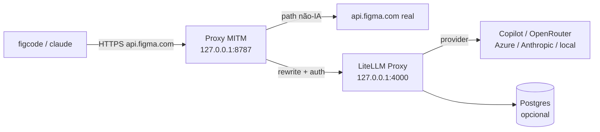
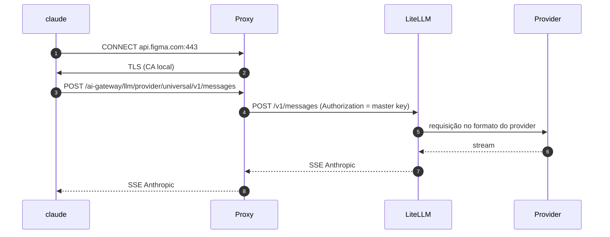

# Arquitetura — Gateway

> O gateway é a camada local que intercepta a inferência do Figma e a entrega ao **LiteLLM Proxy**,
> que faz a tradução para o provedor escolhido. O app desktop (Tauri) supervisiona os processos.
> Ver [desktop-app.md](desktop-app.md) e [onboarding.md](onboarding.md).

## 1. Princípios

1. **Transparência** — o figcode/Claude Code não percebe a troca.
2. **Reuso** — a camada de providers é o LiteLLM; não construímos adapters próprios.
3. **Streaming primeiro** — SSE repassado sem buffering.
4. **Local por padrão** — loopback, sem telemetria externa.
5. **Versão fixada** — LiteLLM `v1.108.1`; atualização é release nossa.
6. **Passthrough** — tudo que não é IA passa intacto.

## 2. Componentes



| Componente | Responsabilidade |
|---|---|
| Proxy MITM | TLS seletivo em `api.figma.com`, rewrite de path e `Authorization`, túnel para o resto |
| CA local | Emitir o certificado de `api.figma.com` e ser confiada pelo Windows |
| LiteLLM Proxy | Ingress Anthropic (`/v1/messages`, `count_tokens`), tradução, streaming, fallback, retry |
| Postgres | Necessário para OAuth do Copilot (e recursos de DB do LiteLLM) |
| App Tauri | Ciclo de vida, onboarding, tray, config e logs |

## 3. Por que LiteLLM e o que não construímos

O LiteLLM já entrega:

- `POST /v1/messages` no formato Anthropic e `POST /v1/messages/count_tokens`;
- tradução para 100+ providers;
- streaming SSE, fallback, retry, load balancing;
- catálogo de modelos, descoberta (`/v1/models`), custos e logs;
- suporte documentado a Claude Code e ao Copilot via OAuth.

**Não construímos:** adapters por provider, IR canônica, encoder SSE, contador de tokens, retry e
roteamento. Isso reduz o nosso código à camada específica da Figma.

## 4. Perfis de execução

| Perfil | Providers | Postgres | Quando |
|---|---|---|---|
| **Leve** | OpenRouter, Azure AI, Anthropic, OpenAI, Gemini, local | Não | padrão |
| **Copilot** | Tudo do leve + GitHub Copilot | Sim (embutido) | quando o usuário conecta Copilot |

O Copilot exige Postgres porque o LiteLLM só aceita **Per-user GitHub OAuth** para esse provider e
armazena o token no banco.

## 5. Fluxo de uma requisição



Regras do proxy:

| Host/path | Ação |
|---|---|
| `api.figma.com/ai-gateway/llm/provider/universal/*` | MITM + rewrite + auth |
| `api.figma.com/*` | MITM + forward intacto |
| `www.figma.com`, `mcp.figma.com`, `desktop.figma.com` | túnel CONNECT |
| `localhost`, `127.0.0.1` | túnel direto |

## 6. Roteamento de modelos

O figcode envia nomes nativos (`claude-opus-4-8`, `claude-haiku-4-5`). No LiteLLM eles são aliases:

```yaml
model_list:
  - model_name: claude-opus-4-8
    litellm_params:
      model: github_copilot/claude-sonnet-5.5
      litellm_credential_name: github-copilot
  - model_name: claude-haiku-4-5
    litellm_params:
      model: openrouter/anthropic/claude-haiku-4.5
      api_key: os.environ/OPENROUTER_API_KEY

router_settings:
  fallbacks:
    - claude-opus-4-8: ["claude-haiku-4-5"]
  num_retries: 2
```

- Nomes públicos precisam começar com `claude-`/`anth-` para o Claude Code aceitar.
- O picker do figcode continua mostrando os nomes do catálogo do Claude Code; o mapeamento é invisível.
- Descoberta de modelos (`CLAUDE_CODE_ENABLE_GATEWAY_MODEL_DISCOVERY`) é opcional e depende do host
  gerenciar o env; validar antes de prometer.

## 7. Autenticação

- O figcode envia `Authorization: Bearer <token efêmero da Figma>`.
- O proxy **descarta** esse token e usa `LITELLM_MASTER_KEY` (ou uma virtual key) com o LiteLLM.
- O LiteLLM usa as credenciais do provider (env/keychain) ou o OAuth do Copilot.
- A renovação do token da Figma continua funcionando: acontece entre web app e Figma, não no gateway.

## 8. SQLite: decisão

**Não** usamos SQLite como banco do LiteLLM Proxy:

- o schema é PostgreSQL-only (`provider = "postgresql"` no Prisma);
- a feature request de SQLite foi fechada como **not planned** ([#4583](https://github.com/BerriAI/litellm/issues/4583));
- o Copilot exige que o token fique no banco.

SQLite pode ser usado **pelo nosso app** para estado local (config, logs, histórico), nunca como banco
do LiteLLM. A alternativa sem Postgres seria trocar o Proxy pelo SDK sidecar, assumindo o shim
`/v1/messages` — decisão descartada para manter o Copilot no caminho suportado.

## 9. Segurança

| Item | Decisão |
|---|---|
| Bind | `127.0.0.1` apenas |
| Master key | Aleatória por instalação, no Credential Manager/DPAPI |
| Salt key | Estável; sem ela os tokens do Copilot ficam ilegíveis |
| CA | Privada protegida, validade curta, remoção no uninstall |
| Logs | Prompt/resposta desligados por padrão; headers redigidos |
| Supply chain | Manifesto assinado + SHA-256 dos artefatos |
| Versão | `v1.108.1`; **não usar `v1.107.0`** (comprometida) |

## 10. Resiliência e desempenho

- Health check do LiteLLM antes de liberar o proxy.
- Restart com backoff; Job Object garante limpeza dos filhos.
- Timeout de first byte, idle e total.
- Fallback por modelo no LiteLLM.
- Se o LiteLLM cair, o proxy retorna erro claro; opção fail-open (túnel direto para a Figma) é
  configurável, mas desligada por padrão.

## 11. Stack e organização

- **App**: Tauri v2 (Rust + React/Vite).
- **Proxy**: Rust (`hudsucker` ou hyper + rustls).
- **Engine**: LiteLLM Proxy `v1.108.1` (Python, sidecar).
- **Banco**: Postgres embutido (`postgresql_embedded` ou binários gerenciados).
- **Estado do app**: SQLite/JSON.

```text
app/
├── src-tauri/        # supervisor, proxy, CA, tray, onboarding
├── ui/               # dashboard, wizard, providers, logs
└── runtime/          # LiteLLM/Postgres baixados
```

## 12. Estratégia de testes

| Nível | O que cobre |
|---|---|
| Unitário | Rewrite de path/auth, parsing do manifesto, redaction |
| Integração | Proxy + LiteLLM fake; SSE, tools, erros |
| Contrato | Fixtures reais de `/v1/messages` e `count_tokens` |
| E2E | Figma + app + provider real (sandbox) |
| Caos | Provedor lento/erro, queda no meio do stream, token expirado |
| Regressão | Tráfego não-IA intacto; rollback de CA/env |

## 13. Decisões pendentes

1. Fail-open vs. fail-closed por padrão.
2. Expor seletor de modelo próprio (exige patch de UI) ou só config.
3. Persistir histórico no SQLite do app (privacidade vs. diagnóstico).
4. Múltiplos perfis de configuração por projeto/time.
