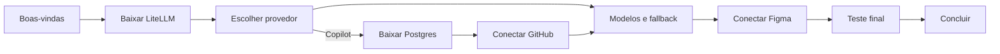

# Instalação e onboarding

> Instalador mínimo + tour de configuração no first-run. O objetivo é não obrigar todo mundo a baixar
> ~500 MB: o app instala leve e baixa LiteLLM/Postgres sob demanda.

## 1. O que vai no instalador

| Incluído | Não incluído |
|---|---|
| App Tauri (Rust + WebView2 + UI) | LiteLLM runtime |
| Gerador de CA e proxy MITM | Postgres |
| Cliente de download/verificação | Chaves de provider |
| WebView2 bootstrapper (se necessário) | Modelos/pesos |

Tamanho alvo: **15–30 MB**.

## 2. Tour de configuração



O wizard é um estado persistido (`setup.json`). Fechar no meio e reabrir retoma no passo pendente.
Pode ser reaberto pelo tray em “Reconfigurar”.

### Passo 0 — Boas-vindas

- Checa Windows x64, espaço em disco, internet e instalação do Figma.
- Explica em 3 bullets o que será instalado.
- “Continuar” e “Já tenho os pacotes” (modo offline).

### Passo 1 — Baixar LiteLLM

- Baixa `litellm-runtime-1.108.1-win-x64.zip` (artefato gerado por nós, não o PyPI cru).
- Progresso com pausar/retomar (HTTP Range), velocidade e cancelar.
- Verifica SHA-256 do manifesto e assinatura Ed25519 do manifesto.
- Extrai em pasta versionada, roda `litellm --version` e confere.
- Falha: retry com backoff, espelho, importar pacote local.

### Passo 2 — Escolher provedor

| Card | Campos | Observação |
|---|---|---|
| OpenRouter | API key | caminho mais rápido |
| Azure AI | endpoint, key, api_version | Azure OpenAI/Foundry |
| Anthropic | API key | |
| OpenAI | API key | |
| **GitHub Copilot** | “Conectar GitHub” | requer Postgres + OAuth |

Sub-fluxo do Copilot:

1. baixa o Postgres embutido (~30–60 MB);
2. inicializa o cluster e sobe;
3. sobe o LiteLLM com `DATABASE_URL`;
4. cria a credential `github-copilot` e o alias do modelo principal do seletor;
5. abre a UI do LiteLLM (ou device flow) e mostra código/link;
6. espera “Connected” e testa uma chamada.

Avança com teste OK, ou “pular com aviso”.

### Passo 3 — Modelos e fallback

- Exibe os ids que o cliente envia — codenames da Figma (`anthropic-claude-5.5-opus`,
  `figaro-gpt-6-sol`, `aqua`, `default`) e os `claude-*` do agente — com um alias por id.
- Pré-preenche com o modelo do passo 2.
- Permite fallback (ex.: Copilot → OpenRouter).
- Gera `config.yaml` e reinicia o LiteLLM.

### Passo 4 — Conectar Figma

- Detecta `%LOCALAPPDATA%\Figma\...` e a versão; se não houver, link oficial + “pular”.
- Mostra o que muda: CA em `CurrentUser\Root` e proxy em loopback; nada no env do usuário nem no
  WinINET.
- “Instalar integração” (sem admin) → CA + proxy + abertura do Figma com o proxy injetado no processo.
- Se o Figma estiver aberto, oferece “Fechar e reabrir” (aviso de trabalho não salvo) ou “depois”.
- Marca verde quando a primeira requisição de IA passa pelo proxy.

### Passo 5 — Teste e conclusão

- Status: Postgres, LiteLLM, proxy, CA, env, Figma.
- Teste ponta a ponta opcional (prompt curto).
- Toggle “Iniciar com o Windows”.
- “Abrir dashboard” e “Concluir”.

## 3. Download e atualização de componentes

### Manifesto

```json
{
  "litellm": {
    "version": "1.108.1",
    "url": "https://.../litellm-runtime-1.108.1-win-x64.zip",
    "sha256": "...",
    "size": 0
  },
  "pgsql": {
    "version": "16.x",
    "url": "https://.../pgsql-16.x-win-x64.zip",
    "sha256": "...",
    "size": 0
  }
}
```

- Manifesto em HTTPS, versionado e **assinado** (Ed25519; chave pública embutida no app).
- `minAppVersion` para compatibilidade.
- Espelhos configuráveis (GitHub Releases, S3/CloudFront).
- Importação offline de um ZIP local.

### Instalação atômica

1. Baixa para `tmp`.
2. Confere tamanho e SHA-256 (e assinatura do manifesto).
3. Extrai para `runtime/<componente>-<versao>`.
4. Valida a execução (`--version`).
5. Troca o ponteiro “ativo”.
6. Em erro, mantém a versão anterior e faz rollback.

Atualizações de runtime são releases nossas, testadas; nunca auto-update silencioso.

### Artefatos de CI

- `litellm-runtime-<versao>-win-x64.zip` (PyInstaller one-folder ou venv selado).
- `pgsql-<versao>-win-x64.zip`.
- `manifest.json` + assinatura.

## 4. Estado e retomada

`setup.json` guarda:

- passos concluídos;
- provedor escolhido;
- versões instaladas;
- portas;
- integração ativa/inativa.

Reabrir o app retoma o wizard no primeiro passo pendente. “Refazer configuração” reseta o estado sem
apagar credenciais, salvo confirmação.

## 5. Casos de borda

| Situação | Comportamento |
|---|---|
| Sem internet | retry, espelho, importar pacote local |
| Hash inválido | apaga e baixa de novo; nunca extrai |
| Disco cheio | bloqueia com o tamanho necessário |
| Antivírus/política bloqueia CA | instruções e instalação manual |
| Porta ocupada | escolhe outra e persiste |
| Env de proxy já existente | detecta, avisa e oferece mesclar/restaurar |
| Figma atualizado | integração continua (host/path); revalida versão |
| Copilot sem modelo no plano | erro claro do GitHub no passo 2 |
| Usuário fecha o app no meio | estado salvo; retoma depois |

## 6. Decisões pendentes

| Tema | Recomendação |
|---|---|
| Onde publicar artefatos | GitHub Releases + espelho S3 |
| Copilot no first-run | Oferecer no passo 2, com sub-fluxo separado |
| Pular Figma | Permitir, com badge “pendente” no dashboard |
| Assinatura de código | Assinar instalador e binários |
| Idioma | pt-BR no MVP; i18n depois |
